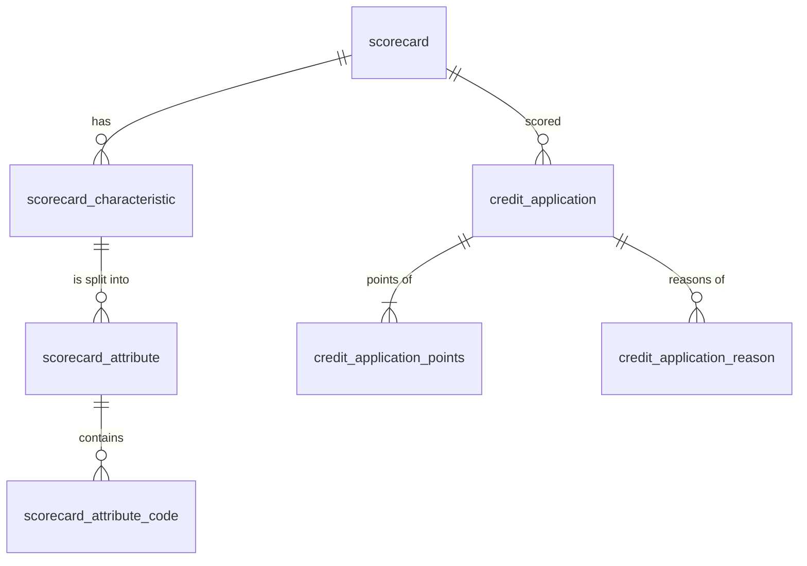

# Credit scoring API

[](https://github.com/davideMcbb/credit-scoring-api/actions/workflows/ci.yml)

A REST service in **Java 21 + Spring Boot 3.5 + PostgreSQL** that scores loan applications with the points scorecard I built and validated in [credit-scoring](https://github.com/davideMcbb/credit-scoring) (Python). The Python project answers *is the model any good?*; this one answers *how would a bank run it?*

- The scorecard lives in the database as data (versioned, one active at a time), not in the code.
- Every scored application is stored with the points of each characteristic and the reasons, so a decision can be audited later.
- An integration test checks that the service gives **the same score, probability of default, decision and reasons as the Python code for all 1,000 loans** of the data set.

## What it does

`POST /api/applications` with the ten characteristics of the scorecard:

```bash
curl -s -X POST localhost:8080/api/applications -H 'Content-Type: application/json' -d '{
  "durationMonths": 48, "amount": 10000, "age": 21,
  "employmentDuration": "UNDER_1_YEAR", "installmentRate": "UNDER_20_PERCENT",
  "checkingAccount": "NO_CHECKING_ACCOUNT", "creditHistory": "PAST_DELAYS",
  "purpose": "RADIO_TV", "savings": "NONE_OR_UNKNOWN", "otherDebtors": "NONE"}'
```

```json
{
  "id": "6f1c…",
  "scorecardVersion": "1.0",
  "score": 422,
  "probabilityOfDefault": 0.90525151,
  "decision": "REJECT",
  "reasons": [
    { "characteristic": "purpose", "pointsBelowAverage": 29.494286 },
    { "characteristic": "status",  "pointsBelowAverage": 24.685714 },
    { "characteristic": "amount",  "pointsBelowAverage": 21.400000 }
  ],
  "points": [ { "characteristic": "duration", "value": "48", "attribute": "> 36", "points": 38 }, … ]
}
```

| Endpoint | |
|---|---|
| `POST /api/applications` | score an application and store it (201 with `Location`) |
| `GET /api/applications/{id}` | a stored application |
| `GET /api/applications?decision=REJECT&page=0&size=20` | stored applications, newest first |
| `GET /api/scorecard` | the active scorecard: every class and its points |
| `GET /swagger-ui.html` | interactive documentation (OpenAPI) |
| `GET /actuator/health` | health check |

Invalid requests get a `400` with an [RFC 9457](https://www.rfc-editor.org/rfc/rfc9457) problem detail that names the field, for example `"Invalid value for 'purpose'. Allowed: OTHERS, NEW_CAR, …"`.

## How the score is computed

Each characteristic falls into a class (for example *duration > 36 months*) worth a whole number of points; the score is the sum. The points are scaled so that 600 points mean odds of 50:1 for a good loan in the bank's population and every 20 points double the odds, so

```
probability of default = 1 / (1 + exp((score − 487.12) / 28.854))
```

An application is approved at **542 points or more**: the cutoff that minimises the expected cost at the bank's real bad rate of 5%, with a bad loan costing five times a rejected good one. The Python paper explains why the cutoff has to be set for the population and not for the 30% bad rate of the sample.

**Reasons.** The service reports up to three characteristics where the applicant gets the most points *below the average applicant*. The usual method, comparing with the best class, put "no guarantor" among the top three reasons for 96% of rejected applicants in my validation: true, but not useful; comparing with the average gives the reasons that actually separate the applicant from the others.

A category never seen when the scorecard was estimated (the data have no loan for education) gets neutral points.

## Design

```
scoring/      the scorecard logic in plain Java: no Spring, no database, easy to unit test
scorecard/    loads the active scorecard from PostgreSQL (cached) and publishes it
application/  REST API, validation, persistence of scored applications
web/          error handling and paging
```



- The schema is created by **Flyway** migrations; Hibernate only validates it. `V2__scorecard_1_0.sql` is generated from the Python project by `tools/export_scorecard.py`, so the two can never drift apart silently.
- A partial unique index allows only one active scorecard. Check constraints reject impossible values at the database level too.
- Applications are exposed by a random UUID, not by the database id.
- The scorecard is checked when it is loaded: numeric bounds must increase, a code cannot be in two classes, a characteristic cannot appear twice.

## Tests

```bash
mvn test      # unit tests of the scoring logic, no Docker needed
mvn verify    # also the integration tests, on a real PostgreSQL started by Testcontainers (needs Docker)
```

- `ScorecardTest`, `RuleTest`: class boundaries, neutral points, the probability formula, the cutoff, the order of the reasons, validation of a broken scorecard.
- `GoldenCasesIT`: 1,000 loans, Java against Python.
- `ApplicationApiIT`: the REST API end to end, including errors, paging and reading back a stored application.

GitHub Actions runs `mvn verify` and builds the Docker image on every push.

## Run it

With Docker only:

```bash
export DB_PASSWORD=choose-one       # PowerShell: $env:DB_PASSWORD="choose-one"
docker compose up --build
```

then open <http://localhost:8080/swagger-ui.html>. With Java 21 and Maven, `mvn spring-boot:test-run` starts the service on a temporary PostgreSQL container.

## Limits

- The scorecard comes from 1,000 loans of a German bank in 1973–1975, with amounts in Deutsche Mark. It shows how a scorecard is run, not a model to lend money with.
- There is no authentication: in a bank the service would sit behind the API gateway, with access per role and an audit log of who asked for each decision.
- Scoring is synchronous. A real origination flow would also publish an event for each decision (for example on Kafka) for monitoring and reporting.

## Data and licence

Code under the MIT licence. The scorecard and the expected results are derived from the South German Credit data (Grömping, 2019; UCI Machine Learning Repository), CC BY 4.0; see [credit-scoring/data](https://github.com/davideMcbb/credit-scoring/tree/main/data).
